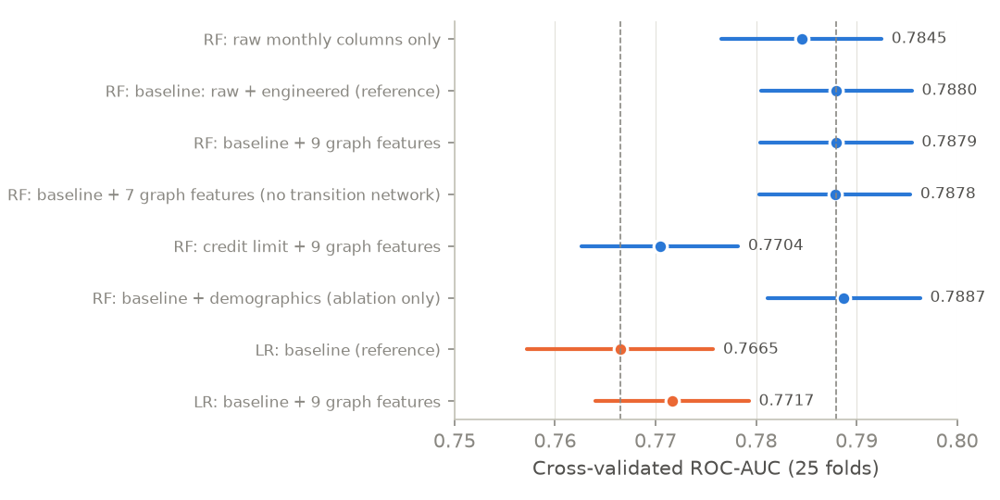
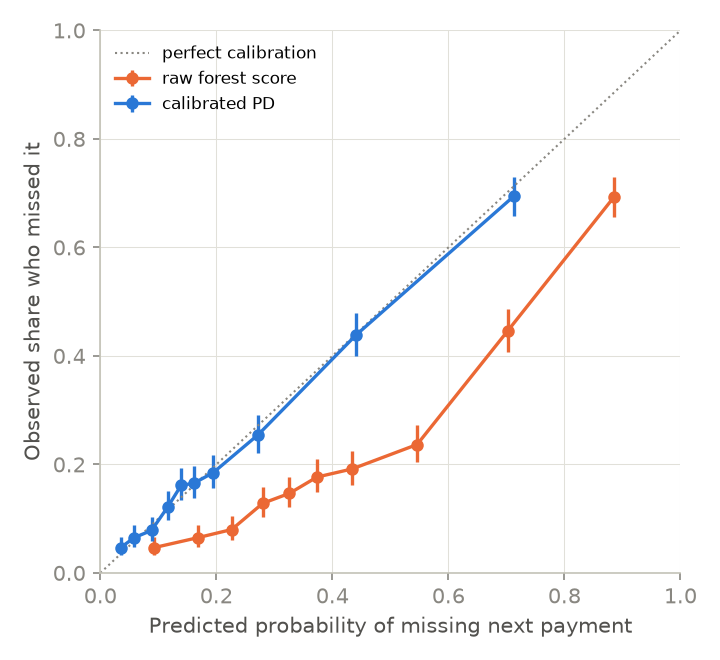
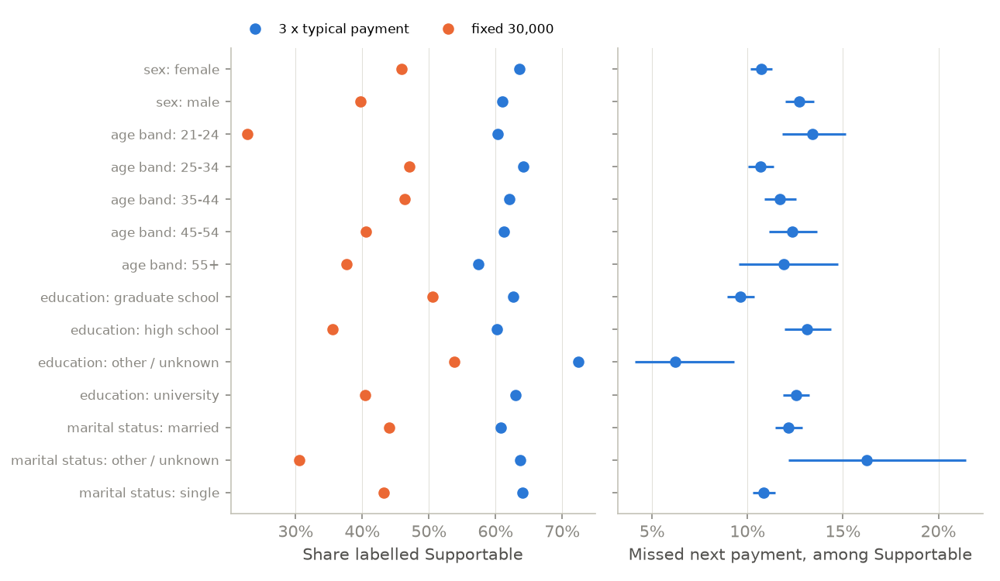

# Final report: knowledge-graph-driven credit risk and credit-increase analysis

*Generated by `notebooks/09_final_evaluation.ipynb` on 2026-11-09T17:17:32 from `outputs/reports/phase9_results.json`. Do not edit by hand.*

> **The credit-increase score is a demonstrative scenario framework, not a lending policy.** The data contains no credit-increase requests or outcomes, and card payments are payment behaviour, not income.

## 1. Question and short answer

**Can a temporal knowledge graph of six months of card behaviour provide useful information for credit-risk modelling and for explainable credit-increase analysis?**

- **Random Forest + graph features:** no reliable difference (test ΔROC-AUC -0.0008, 95% CI [-0.0019, +0.0004]).
- **Logistic regression + graph features:** reliable improvement (test ΔROC-AUC +0.0065, 95% CI [+0.0027, +0.0101]; CV +0.0052, B better in 24/25 folds).
- **Graph neural network (graph only):** CV ROC-AUC 0.7829 vs 0.7883 for the engineered forest; difference -0.0053, CI [-0.0089, -0.0018] (reliably worse).
- **Explanation:** the graph finds outcome-blind patterns that hold on the test set, e.g. late 3+ months in a row → 60.4% missed the next payment; always paid in full → 12.0% (base rate 22.1%).
- **Calibration:** the probability the score uses has Brier 0.1346 (base-rate predictor 0.1723) and expected calibration error 0.011.
- **Score vs outcomes (3 × typical payment, test):** 11.0% → 32.2% → 62.0% missed the next payment (Supportable → Review → Not supportable); with the model removed completely: 11.4% → 29.8% → 65.8%.
- **Fairness:** with requests sized to the customer, the lowest selection ratio is 0.83; with a fixed 30,000 it falls to 0.48 (age band).

## 2. Pipeline health check

- Data: 30,000 unique customers, 180,000 monthly rows, test share 20%, default rate 22.1% train / 22.1% test.
- Graph: counts match exactly (240,005 nodes, 540,000 relationships), 0 nodes and 0 relationships carry an outcome property, 0 `NEXT_MONTH` links out of order.
- Tests: `32 passed in 6.76s`.
- Terminology: 12 lines mention income/salary; 0 problems (2 non-negated line(s) only describe the lint check itself).

## 3. Data and graph patterns

**Behaviour hypotheses (training customers).**

| Hypothesis | Verdict | Default rate, lowest bucket | Default rate, highest bucket |
|---|---|---|---|
| H1  higher utilization -> more default | NOT SUPPORTED (non-monotone shape) | 35.8% | 35.0% |
| H1b same, active users only (util > 10%) | SUPPORTED | 16.0% | 35.0% |
| H2  more late months -> more default | SUPPORTED | 11.5% | 69.7% |
| H3  higher payment coverage -> less default | SUPPORTED | 57.7% | 16.8% |
| H4  rising utilization (slope) -> more default | NOT SUPPORTED (opposite direction) | 29.9% | 21.4% |
| H5  rising payments (slope) -> less default | NOT SUPPORTED (non-monotone shape) | 22.1% | 21.2% |
| H6  rising bills (slope) -> more default | NOT SUPPORTED (opposite direction) | 29.8% | 21.4% |
| H7  less consistent payments (CV) -> more default | PARTLY (mostly in expected direction) | 19.1% | 20.4% |
| H8  higher credit limit -> less default | SUPPORTED | 32.2% | 13.1% |
| H9  larger typical payment -> less default | SUPPORTED | 28.4% | 12.8% |
| H10 30k request is large vs typical payment -> more default | SUPPORTED | 4.6% | 28.6% |

**Patterns found by Cypher (the graph never sees the outcome).**

| Pattern | Customers | Train | Test | Lift |
|---|---|---|---|---|
| Q1 late in >=3 of 6 months | 3,744 | 59.9% | 60.3% | 2.71× |
| Q2 late >=3 months in a row | 3,297 | 60.4% | 60.4% | 2.73× |
| Q3 utilization >=90% in >=3 months | 5,062 | 30.5% | 28.5% | 1.38× |
| Q4 utilization rose >=3 months running | 1,300 | 19.3% | 22.5% | 0.87× |
| Q5 recovered and clean in last 3 months | 1,629 | 23.5% | 18.4% | 1.06× |
| Q6 paid <10% of statement in >=3 months | 15,433 | 26.7% | 26.1% | 1.21× |
| Q7 always paid in full, never late | 3,652 | 11.8% | 12.0% | 0.53× |
| Q8 >=2 concerning signals | 8,149 | 42.9% | 41.8% | 1.94× |
| Q10 relapse (late, recovered, late again) | 1,073 | 54.4% | 52.5% | 2.46× |

## 4. Ablation: does the graph help, and for which model?

Cross-validation: 25 identical folds (5 × 5 repeated) on training customers; intervals use the Nadeau–Bengio correction for overlapping folds. Ablations were run in CV only; the test set was used once per final model.

| Model | Features | n | CV ROC-AUC [95% CI] | Δ vs reference [95% CI] | Folds better | Verdict |
|---|---|---|---|---|---|---|
| Random Forest | raw monthly columns only | 19 | 0.7845 [0.7766, 0.7925] | -0.0035 [-0.0053, -0.0017] | 1/25 | reliably worse |
| Random Forest | baseline: raw + engineered (reference) | 37 | 0.7880 [0.7805, 0.7955] | reference | – | – |
| Random Forest | baseline + 9 graph features | 46 | 0.7879 [0.7804, 0.7955] | -0.0001 [-0.0008, +0.0007] | 12/25 | no reliable difference |
| Random Forest | baseline + 7 graph features (no transition network) | 44 | 0.7878 [0.7804, 0.7953] | -0.0002 [-0.0009, +0.0006] | 10/25 | no reliable difference |
| Random Forest | credit limit + 9 graph features | 10 | 0.7704 [0.7626, 0.7782] | -0.0176 [-0.0221, -0.0131] | 0/25 | reliably worse |
| Random Forest | baseline + demographics (ablation only) | 41 | 0.7887 [0.7812, 0.7963] | +0.0007 [-0.0002, +0.0017] | 19/25 | no reliable difference |
| Logistic regression | baseline (reference) | 37 | 0.7665 [0.7572, 0.7757] | reference | – | – |
| Logistic regression | baseline + 9 graph features | 46 | 0.7717 [0.7640, 0.7793] | +0.0052 [+0.0023, +0.0081] | 24/25 | reliable improvement |

**Test set (6,000 customers, 2,000 paired bootstrap resamples).**

| Model | ROC-AUC [95% CI] | PR-AUC [95% CI] |
|---|---|---|
| RF A | 0.7800 [0.7658, 0.7950] | 0.5575 [0.5302, 0.5876] |
| RF B | 0.7792 [0.7650, 0.7939] | 0.5566 [0.5293, 0.5865] |
| LR-A | 0.7573 [0.7424, 0.7729] | 0.5021 [0.4741, 0.5320] |
| LR-B | 0.7638 [0.7485, 0.7796] | 0.5197 [0.4925, 0.5495] |

| Comparison | ΔROC-AUC [95% CI] | ΔPR-AUC [95% CI] | Verdict |
|---|---|---|---|
| Random Forest: B − A | -0.0008 [-0.0019, +0.0004] | -0.0009 [-0.0032, +0.0013] | no reliable difference |
| Logistic regression: LR-B − LR-A | +0.0065 [+0.0027, +0.0101] | +0.0176 [+0.0066, +0.0284] | reliable improvement |

Why: each customer's graph is a six-node chain built from the same 23 columns. A forest learns streaks and recoveries from the raw monthly columns directly; a linear model cannot, so for it the graph features add information. On their own (credit limit + graph features) they reach 0.7704, so they are informative but redundant for the forest.



## 5. Calibration

The score reads the model output as a probability, so it must be calibrated. Model A, isotonic calibration inside cross-validation; test customers below.

|  | Brier | Brier skill vs base rate | ECE | Mean predicted | Observed | Slope | Intercept |
|---|---|---|---|---|---|---|---|
| Raw forest score | 0.1732 | -0.005 | 0.182 | 0.404 | 0.221 | 0.94 | -1.13 |
| Calibrated PD (used by the score) | 0.1346 | +0.218 | 0.011 | 0.222 | 0.221 | 0.95 | -0.06 |



## 6. Credit-increase score vs real outcomes (test customers)

Necessary, not sufficient: missing a payment is not the same as an increase going badly.

| Request | Version | Label | Customers | Missed next payment [95% CI] |
|---|---|---|---|---|
| 3 x typical payment | full score | Supportable | 3,734 | 11.0% [10.0%, 12.0%] |
| 3 x typical payment | full score | Review | 320 | 32.2% [27.3%, 37.5%] |
| 3 x typical payment | full score | Not supportable | 868 | 62.0% [58.7%, 65.1%] |
| 3 x typical payment | full score | Insufficient evidence | 1,078 | 25.5% [23.0%, 28.2%] |
| 3 x typical payment | model-risk factor removed (PD gate kept) | Supportable | 3,707 | 11.4% [10.4%, 12.4%] |
| 3 x typical payment | model-risk factor removed (PD gate kept) | Review | 437 | 27.9% [23.9%, 32.3%] |
| 3 x typical payment | model-risk factor removed (PD gate kept) | Not supportable | 778 | 65.4% [62.0%, 68.7%] |
| 3 x typical payment | model-risk factor removed (PD gate kept) | Insufficient evidence | 1,078 | 25.5% [23.0%, 28.2%] |
| 3 x typical payment | model removed completely | Supportable | 3,707 | 11.4% [10.4%, 12.4%] |
| 3 x typical payment | model removed completely | Review | 466 | 29.8% [25.9%, 34.1%] |
| 3 x typical payment | model removed completely | Not supportable | 740 | 65.8% [62.3%, 69.1%] |
| 3 x typical payment | model removed completely | Insufficient evidence | 1,087 | 25.8% [23.2%, 28.4%] |
| fixed 30,000 | full score | Supportable | 2,604 | 9.4% [8.4%, 10.6%] |
| fixed 30,000 | full score | Review | 1,213 | 15.7% [13.7%, 17.8%] |
| fixed 30,000 | full score | Not supportable | 1,105 | 55.8% [52.8%, 58.7%] |
| fixed 30,000 | full score | Insufficient evidence | 1,078 | 25.5% [23.0%, 28.2%] |
| fixed 30,000 | model-risk factor removed (PD gate kept) | Supportable | 1,638 | 8.8% [7.5%, 10.3%] |
| fixed 30,000 | model-risk factor removed (PD gate kept) | Review | 1,754 | 12.9% [11.5%, 14.6%] |
| fixed 30,000 | model-risk factor removed (PD gate kept) | Not supportable | 1,530 | 44.5% [42.0%, 47.0%] |
| fixed 30,000 | model-risk factor removed (PD gate kept) | Insufficient evidence | 1,078 | 25.5% [23.0%, 28.2%] |
| fixed 30,000 | model removed completely | Supportable | 1,638 | 8.8% [7.5%, 10.3%] |
| fixed 30,000 | model removed completely | Review | 1,754 | 12.9% [11.5%, 14.6%] |
| fixed 30,000 | model removed completely | Not supportable | 1,521 | 44.4% [42.0%, 46.9%] |
| fixed 30,000 | model removed completely | Insufficient evidence | 1,087 | 25.8% [23.2%, 28.4%] |

Stability (22 one-at-a-time changes: weights ±20%, breakpoints ±10%): Spearman ≥ 0.997, at most 3.0% of labels change (worst: weight payback x1.2).

## 7. Fairness audit

Sex, age, education and marital status are not inputs to the model or the score (shuffling them changes no scores). Outcomes are still measured per group, because other inputs can correlate with them. All 30,000 customers; every probability is out-of-sample.

| Request | Attribute | Lowest selection ratio | Supportable rate range | Miss rate if Supportable, range | Equal-opportunity gap |
|---|---|---|---|---|---|
| 3 x typical payment | sex | 0.96 | 61.0% – 63.6% | 10.7% – 12.7% | 1.5 pts |
| 3 x typical payment | age band | 0.90 | 57.5% – 64.1% | 10.7% – 13.4% | 2.8 pts |
| 3 x typical payment | education | 0.83 | 60.1% – 72.4% | 6.2% – 13.1% | 3.3 pts |
| 3 x typical payment | marital status | 0.95 | 60.7% – 64.0% | 10.8% – 16.2% | 2.5 pts |
| fixed 30,000 | sex | 0.86 | 39.7% – 45.9% | 8.5% – 9.8% | 5.9 pts |
| fixed 30,000 | age band | 0.48 | 22.7% – 47.1% | 8.1% – 11.1% | 26.3 pts |
| fixed 30,000 | education | 0.66 | 35.5% – 53.8% | 4.8% – 10.1% | 14.8 pts |
| fixed 30,000 | marital status | 0.69 | 30.5% – 44.1% | 8.2% – 10.4% | 16.2 pts |

Selection ratio = group's Supportable rate ÷ most-favoured group's (0.8 is a common rule-of-thumb flag, not a legal test). Equal-opportunity gap = largest difference, among customers who did not miss a payment, in the share labelled Supportable.

**Per group, 3 × typical payment.**

| Attribute | Group | n | Supportable | Ratio | Observed miss rate | Mean predicted | Missed if Supportable [95% CI] | Supportable among non-missers |
|---|---|---|---|---|---|---|---|---|
| sex | female | 18,112 | 63.6% | 1.00 | 20.8% | 21.3% | 10.7% [10.2%, 11.3%] | 71.6% |
| sex | male | 11,888 | 61.0% | 0.96 | 24.2% | 23.4% | 12.7% [12.0%, 13.5%] | 70.2% |
| age band | 21-24 | 2,685 | 60.3% | 0.94 | 27.2% | 28.0% | 13.4% [11.8%, 15.1%] | 71.7% |
| age band | 25-34 | 13,011 | 64.1% | 1.00 | 20.3% | 21.2% | 10.7% [10.0%, 11.4%] | 71.8% |
| age band | 35-44 | 9,018 | 62.1% | 0.97 | 21.9% | 21.2% | 11.7% [10.9%, 12.5%] | 70.2% |
| age band | 45-54 | 4,233 | 61.3% | 0.96 | 23.9% | 22.9% | 12.3% [11.1%, 13.7%] | 70.6% |
| age band | 55+ | 1,053 | 57.5% | 0.90 | 26.7% | 25.5% | 11.9% [9.6%, 14.7%] | 69.0% |
| education | graduate school | 10,585 | 62.6% | 0.86 | 19.2% | 19.3% | 9.6% [8.9%, 10.3%] | 70.1% |
| education | high school | 4,917 | 60.1% | 0.83 | 25.2% | 25.4% | 13.1% [12.0%, 14.4%] | 69.8% |
| education | other / unknown | 468 | 72.4% | 1.00 | 7.1% | 16.5% | 6.2% [4.1%, 9.3%] | 73.1% |
| education | university | 14,030 | 63.0% | 0.87 | 23.7% | 23.4% | 12.5% [11.9%, 13.2%] | 72.2% |
| marital status | married | 13,659 | 60.7% | 0.95 | 23.5% | 22.3% | 12.1% [11.5%, 12.9%] | 69.7% |
| marital status | other / unknown | 377 | 63.7% | 0.99 | 23.6% | 24.7% | 16.2% [12.1%, 21.4%] | 69.8% |
| marital status | single | 15,964 | 64.0% | 1.00 | 20.9% | 22.0% | 10.8% [10.3%, 11.5%] | 72.2% |

**Where gaps come from.** Group medians of the inputs that size a request:

| Attribute | Group | Median limit | Median typical payment | Mean late months | Points from predicted risk |
|---|---|---|---|---|---|
| sex | female | 150,000 | 1,804 | 0.78 | +8.1 |
| sex | male | 130,000 | 1,650 | 0.92 | +7.0 |
| age band | 21-24 | 50,000 | 1,208 | 1.10 | +4.9 |
| age band | 25-34 | 150,000 | 1,964 | 0.81 | +8.1 |
| age band | 35-44 | 180,000 | 1,977 | 0.77 | +8.2 |
| age band | 45-54 | 130,000 | 1,601 | 0.85 | +7.4 |
| age band | 55+ | 120,000 | 1,473 | 0.98 | +6.2 |
| education | graduate school | 200,000 | 2,000 | 0.67 | +9.0 |
| education | high school | 80,000 | 1,500 | 0.99 | +6.2 |
| education | other / unknown | 170,000 | 2,184 | 0.23 | +10.6 |
| education | university | 110,000 | 1,712 | 0.93 | +7.1 |
| marital status | married | 160,000 | 1,802 | 0.85 | +7.6 |
| marital status | other / unknown | 60,000 | 1,250 | 0.88 | +6.5 |
| marital status | single | 130,000 | 1,750 | 0.82 | +7.7 |

**Inside the Supportable label** (3 × typical payment): predicted vs observed miss rate. Observed above predicted means the model under-predicts that group's risk inside the band.

| Attribute | Group | Supportable customers | Mean predicted | Observed | Observed − predicted | Mean score |
|---|---|---|---|---|---|---|
| sex | female | 11,511 | 11.2% | 10.7% | -0.5 pts | 85.5 |
| sex | male | 7,247 | 11.8% | 12.7% | +0.9 pts | 84.5 |
| age band | 21-24 | 1,619 | 14.9% | 13.4% | -1.5 pts | 82.4 |
| age band | 25-34 | 8,340 | 11.0% | 10.7% | -0.3 pts | 85.4 |
| age band | 35-44 | 5,600 | 10.9% | 11.7% | +0.8 pts | 85.8 |
| age band | 45-54 | 2,594 | 12.1% | 12.3% | +0.3 pts | 84.8 |
| age band | 55+ | 605 | 12.2% | 11.9% | -0.3 pts | 84.0 |
| education | graduate school | 6,626 | 10.4% | 9.6% | -0.8 pts | 87.1 |
| education | high school | 2,957 | 12.7% | 13.1% | +0.4 pts | 83.8 |
| education | other / unknown | 339 | 10.9% | 6.2% | -4.7 pts | 85.2 |
| education | university | 8,836 | 11.9% | 12.5% | +0.7 pts | 84.1 |
| marital status | married | 8,296 | 11.1% | 12.1% | +1.0 pts | 85.5 |
| marital status | other / unknown | 240 | 14.0% | 16.2% | +2.2 pts | 83.2 |
| marital status | single | 10,222 | 11.7% | 10.8% | -0.8 pts | 84.9 |

**Proxy strength** (cross-validated ROC-AUC of predicting the attribute from the score's inputs; 0.5 = no information):

| Attribute | ROC-AUC |
|---|---|
| male | 0.553 |
| age under 30 | 0.651 |
| graduate school | 0.681 |
| married | 0.567 |

Test customers only (3 × typical payment): lowest selection ratio 0.85, largest equal-opportunity gap 3.1 pts.

Nothing was changed in response to this audit. Remedies (group-specific cut-offs, reweighting, a different request rule) are policy decisions.



## 8. Limitations

- **Old, narrow data:** one bank, Taiwan, April–September 2005; six months, one card per customer, no links between customers.
- **No income:** payments are what customers paid toward the card; affordability cannot be judged directly.
- **No real credit-increase outcomes:** the request is a chosen scenario; the score can be shown to be consistent and traceable, not correct.
- **Hand-set weights:** judgement calls; data set the breakpoints and the order of importance; request-vs-limit breakpoints are a policy assumption.
- **Observational model:** nothing is causal; the projected limit is never fed back into the model.
- **The graph adds explanation, not accuracy, for strong models:** it is built from the same 23 columns the models see.
- **Fairness audit is descriptive:** four recorded attributes with coarse, partly undocumented codes; rule-of-thumb reference points, not a legal standard.
- **Single fixed split** (80/20, seed 42); intervals cover resampling noise, not a change of population.

## 9. Conclusion

For **prediction**, the knowledge graph helps only a simple model: logistic regression gains +0.0065 ROC-AUC on the test set (reliable improvement), while the Random Forest moves -0.0008 (no reliable difference), because it already learns the same patterns from the raw monthly columns. Every approach, including a graph neural network, tops out around 0.78–0.79, the limit of what these 23 columns contain. For **explanation**, the graph is useful: without seeing outcomes it finds patterns such as three late months in a row (60% then miss a payment) and supplies the month-by-month evidence behind each decision. The credit-increase score built on top uses calibrated probabilities, is stable to its hand-set weights, sorts real outcomes in the right order even with the model removed, and treats demographic groups similarly when the request is sized to the customer's own payments, which a fixed-size request does not. It remains a demonstration of transparent reasoning, not a validated lending decision.

## 10. Reproduce

```powershell
.\.venv\Scripts\jupyter.exe nbconvert --to notebook --execute --inplace notebooks\09_final_evaluation.ipynb --ExecutePreprocessor.timeout=1800
```
Requires notebooks 01–08 to have been run (their output files) and, for the graph checks, Neo4j running.
